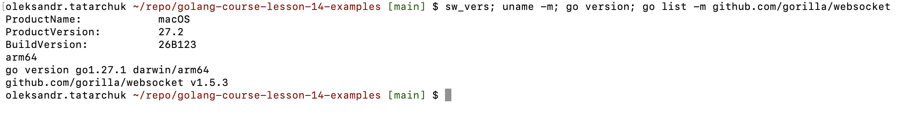
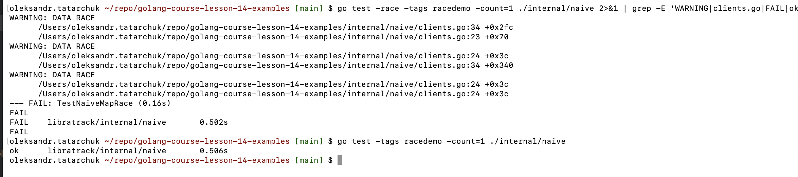
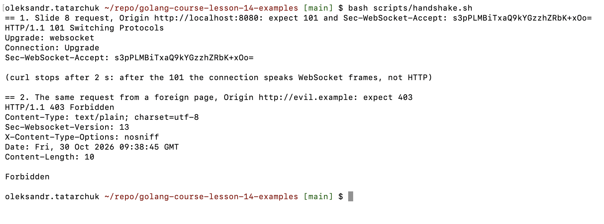
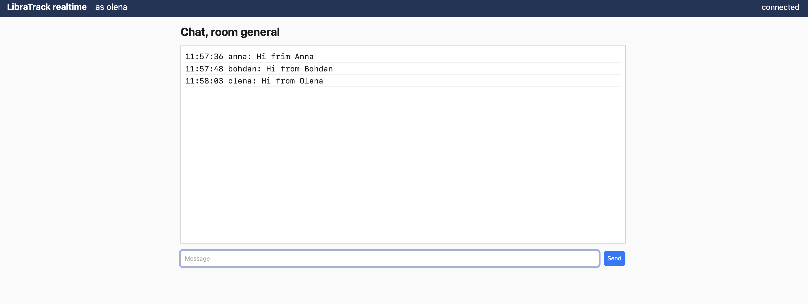
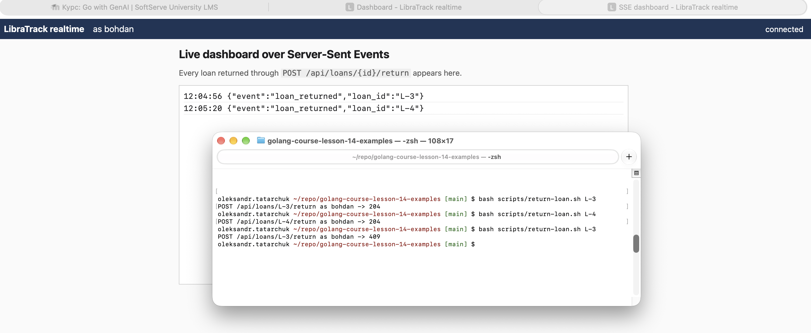
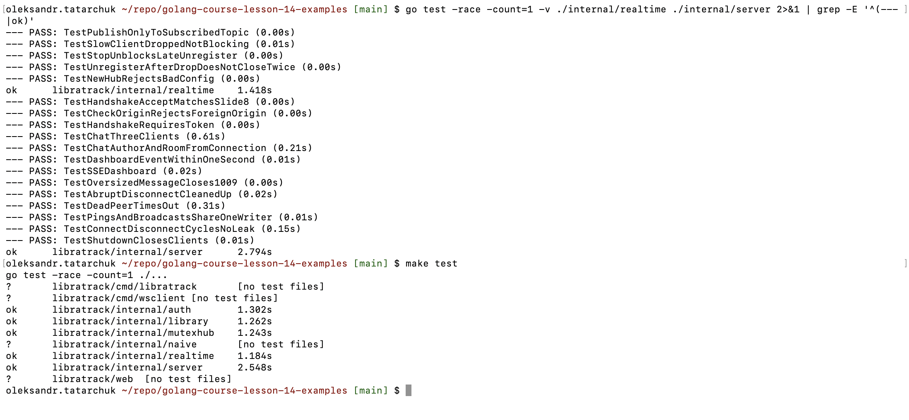
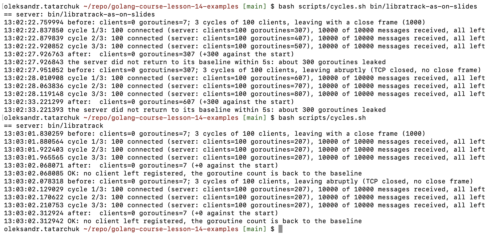
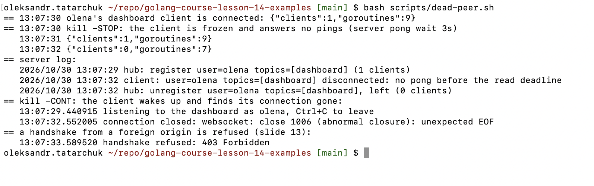

# LibraTrack realtime: приклади Уроку 14

Приклади з презентації Уроку 14 «Магія реального часу: WebSockets і живі оновлення» курсу «Go with GenAI»,
зібрані в один Go-модуль `libratrack` і запущені на власному Mac: WebSocket-рукостискання, хаб на каналах, чат із
кімнатами, живий дашборд і SSE, демонстрації гонки даних і мʼютекса, перевірка `go test -race` і повторних циклів
підключення/відключення, огляд конкурентності хаба за допомогою ШІ.

Чат у власному застосунку (варіант `albums`) — в окремому репозиторії
[golang-course-lesson-14](https://github.com/tatarchuk/golang-course-lesson-14). Умова Теми 14 для обох репозиторіїв:
[albums_lesson14_homework.md](https://github.com/tatarchuk/golang-course-lesson-14/blob/main/albums_lesson14_homework.md).
Звіт — у розділі [Lesson 14 Report: WebSocket Examples](#lesson-14-report-websocket-examples).

## Структура проєкту

| Шлях | Призначення |
|---|---|
| `internal/naive/` | слайд 23: мапа з'єднань без синхронізації; `race_test.go` (тег `racedemo`) показує, що `go test -race` її ловить |
| `internal/mutexhub/` | слайд 24: хаб із `sync.RWMutex`; тест із 50 горутин під `-race` |
| `internal/realtime/` | хаб на каналах (слайди 20, 25–28), `readPump`/`writePump` із ping/pong (14, 15, 27), обробник з `CheckOrigin` (13), чат (40), SSE (30); тести хаба без сокетів |
| `internal/library/` | позики книг і `LoanService.Return` слайда 41, що публікує `loan_returned`; тести |
| `internal/auth/` | JWT (HS256) і middleware слайда 39: токен із заголовка `Authorization` або з параметра `token` |
| `internal/server/` | маршрути: сторінки, демо-логін, API позик, `/ws/chat`, `/ws/dashboard`, `/sse/dashboard`, `/debug/stats`; наскрізні тести слайда 43 через справжні WebSocket-з'єднання |
| `web/` | вбудовані сторінки без фреймворку: логін, чат, дашборд через WebSocket і через SSE; усе виводиться через `textContent` |
| `cmd/libratrack/` | сервер (`127.0.0.1:8080`, прапорці `-origin`, `-pong-wait`), м'яка зупинка закриває клієнтів кодом 1001 |
| `cmd/wsclient/` | термінальний клієнт: `chat`, `listen`, `cycles` (цикли підключення/відключення зі статистикою сервера до і після) |
| `scripts/` | `smoke.sh` (наскрізна перевірка, її запускає CI), `handshake.sh` (слайд 8 вручну), `return-loan.sh` (REST-виклик слайда 41), `cycles.sh` (цикли проти будь-якої збірки сервера), `dead-peer.sh` («мертвий» клієнт і тайм-аут ping/pong) |
| `docs/environment.txt` | версії: macOS, Go, модулі, браузери |
| `docs/slides/` | журнали кожного кроку (таблиця «Докази» нижче) |
| `docs/ai/` | дослівні відповіді ШІ на промпти слайдів 34 і 42 |
| `docs/screenshots/` | знімки S1–S8 з термінала й браузера користувача |
| `prompts.txt` | журнал промптів до ШІ |
| `Makefile` | `run`, `build`, `build-as-on-slides`, `test`, `race-demo`, `cycles` (`make` показує список) |
| `.github/workflows/lesson14-examples-check.yml` | CI: `static`, `test` (`go test -race`, smoke), `race-demo` (слайд 23 має впасти під `-race`) |

## Як запустити

Потрібен лише Go 1.27 (`go.mod`); Docker і VM не потрібні.

```bash
make run                              # сервер на http://localhost:8080 (відкривайте саме localhost: CheckOrigin приймає одне джерело)
make test                             # усі тести з -race
make race-demo                        # слайд 23: детектор гонок на мапі без синхронізації (падає навмисно)
bash scripts/smoke.sh                 # наскрізна перевірка (власний сервер на 127.0.0.1:18090)
```

У браузері: `http://localhost:8080` → демо-користувач (`anna`, `bohdan` чи `olena`, без пароля: це лише демо замість
логіну Теми 9) → чат, дашборд через WebSocket або через SSE. Кожна вкладка тримає свій логін, тож три вкладки — три
користувачі. Із сервером, що працює, у другому терміналі:

```bash
bash scripts/handshake.sh             # слайд 8: 101 і Sec-WebSocket-Accept зі слайда; 403 для чужого Origin
bash scripts/return-loan.sh L-2       # слайд 41: REST-виклик, дашборди отримують loan_returned
make build build-as-on-slides         # bin/libratrack (з виправленнями) і bin/libratrack-as-on-slides (код як на слайдах)
bash scripts/cycles.sh bin/libratrack-as-on-slides   # 3×100 + 3×100 циклів: витік +300 горутин
bash scripts/cycles.sh                # те саме з виправленнями: повернення до базового рівня
bash scripts/dead-peer.sh             # kill -STOP клієнта: сервер відключає його за тайм-аутом ping/pong
```

## Скриншоти

| # | Що показує | Журнал | Знімок |
|---|---|---|---|
| S1 | macOS 27.2, arm64, Go 1.27.1, gorilla/websocket v1.5.3 | [environment.txt](docs/environment.txt) |  |
| S2 | слайд 23: `-race` знаходить три гонки рівно в рядках, які слайд позначає «race!»; без `-race` той самий тест проходить (слайд 44) | [naive-race.txt](docs/slides/naive-race.txt) |  |
| S3 | слайд 8 вручну: `101 Switching Protocols` і `Sec-WebSocket-Accept: s3pPLMBiTxaQ9kYGzzhZRbK+xOo=`; чужий Origin — `403` | [handshake.txt](docs/slides/handshake.txt) |  |
| S4 | слайд 40: чат кімнати general, повідомлення трьох користувачів, кожне рівно один раз (вікно olena) | [run-as-on-slides.txt](docs/slides/run-as-on-slides.txt) |  |
| S5 | слайди 41 і 30: SSE-дашборд отримує `loan_returned` L-3 і L-4 від `return-loan.sh` (204, 204, повтор — 409) | [run-as-on-slides.txt](docs/slides/run-as-on-slides.txt) |  |
| S6 | після виправлень огляду ШІ: 18 тестів хаба й сервера (з них 8, що падали на коді слайдів) і `make test` — усе зелене з `-race` | [tests-after-review.txt](docs/slides/tests-after-review.txt) |  |
| S7 | повторні цикли 3×100 + 3×100: код слайдів лишає +300 горутин на кожен прогін, виправлений повертається до 7 (+0) | [cycles.txt](docs/slides/cycles.txt) |  |
| S8 | «мертвий» клієнт (`kill -STOP`) відключається за 2–3 с при pong wait 3 с; чужий Origin — 403 | [dead-peer.txt](docs/slides/dead-peer.txt) |  |

S1–S3 і S6–S8 — термінал, S4–S5 — Chrome. S4–S5 зняті з кодом як на слайдах (сервер `bin/libratrack-as-on-slides`),
S6–S8 — з виправленим.

## Lesson 14 Report: WebSocket Examples

### Оцінювання

| Завдання | Бали | Де |
|---|---|---|
| Запустити приклади з презентації на власному ПК; перевірити `go test -race` і ручним тестуванням повторних циклів підключення/відключення | 70 | цей репозиторій |
| Додати до свого застосунку онлайн-чат | не вказано | [golang-course-lesson-14](https://github.com/tatarchuk/golang-course-lesson-14) |

Демо-проєкту до Уроку 14 немає, тож «приклади з презентації» — це код на слайдах. Його зібрано в один модуль і пройдено
практичну частину (слайди 38–42) за порядком слайдів: спершу код рівно як на слайдах, потім тести чекліста слайда 43,
огляд ШІ за промптом слайда 42 і виправлення знахідок. Фінальна презентація (пункт 3 слайда 48) у тексті оцінювання
відсутня і не виконувалася.

### Середовище

Усе запущено нативно на Mac ([environment.txt](docs/environment.txt)): macOS 27.2 (arm64, Apple M2 Pro), Go 1.27.1,
`github.com/gorilla/websocket` v1.5.3 (вибір слайда 12), `github.com/golang-jwt/jwt/v5` v5.3.1, Chrome 156, Safari 27.2.
Маршрутизатор — `net/http` (Go 1.22+): код слайдів — звичайні обробники, Gin не потрібен.

### Приклади зі слайдів у коді

| Слайд | Приклад | Файл |
|---|---|---|
| 8 | рукостискання: ключ `dGhlIHNhbXBsZSBub25jZQ==` → `Sec-WebSocket-Accept: s3pPLMBiTxaQ9kYGzzhZRbK+xOo=` | `scripts/handshake.sh`, `TestHandshakeAcceptMatchesSlide8` |
| 13, 16 | `websocket.Upgrader` з `CheckOrigin`, обробник, ліміти | `internal/realtime/ws_handler.go`, `client.go` |
| 14, 15, 27 | читання і запис, ping/pong, `readPump`/`writePump` | `internal/realtime/client.go` |
| 20, 25, 26, 28 | теми pub/sub, головний цикл хаба з єдиним власником, обмежені канали | `internal/realtime/hub.go` |
| 23 | мапа з'єднань без синхронізації | `internal/naive/` |
| 24 | хаб із `sync.RWMutex` | `internal/mutexhub/` |
| 30 | SSE | `internal/realtime/sse_handler.go` |
| 39 | `/ws` за JWT-middleware, токен у query-параметрі | `internal/auth/`, `internal/server/server.go` |
| 40 | чат, автор із claims | `internal/realtime/chat.go`, `web/chat.html` |
| 41 | `LoanService.Return` публікує `loan_returned` | `internal/library/loan_service.go`, `web/dashboard.html` |
| 34, 42 | промпти до ШІ | `prompts.txt`, `docs/ai/` |

### Крок за кроком

1. **Слайди 23 і 24.** Мапа без синхронізації з тестом за тегом `racedemo`: `go test -race` повідомляє три гонки
   рівно в рядках `clients[conn] = true`, `defer delete(clients, conn)` і `for conn := range clients` — тих, що
   слайд позначає «race!»; без `-race` той самий тест проходить. Хаб із `RWMutex` під `-race` чистий
   ([naive-race.txt](docs/slides/naive-race.txt), S2). CI-завдання `race-demo` перевіряє, що гонку знайдено щоразу.
2. **Тести до коду.** Сценарії чекліста слайда 43 і правила слайдів 16, 28, 44, 45 записано тестами раніше за код хаба
   (червоний прогін: [tests-before.txt](docs/slides/tests-before.txt)).
3. **Код рівно як на слайдах** (кроки 1–3 практичної частини: хаб, чат, дашборд) проти цих тестів: 14 із 22 проходять,
   8 падають ([tests-as-on-slides.txt](docs/slides/tests-as-on-slides.txt)), і кожне падіння — те, від чого застерігає
   сама презентація:

   | Тест | Що сталося з кодом слайдів | Про що це на слайдах |
   |---|---|---|
   | `TestSlowClientDroppedNotBlocking` | один клієнт, що не читає, зупиняє хаб: здоровий отримав 3 з 10 | 28, 44: повільний клієнт не має гальмувати розсилку |
   | `TestStopUnblocksLateUnregister` | другий `Stop` — паніка `close of closed channel`; на слайдах зупинки немає взагалі | 27: закриття рівно один раз |
   | `TestChatAuthorAndRoomFromConnection` | кімната береться з повідомлення: клієнт пише в чужу кімнату | 40: не довіряти полям від клієнта |
   | `TestSSEDashboard` | цикл слайда 30 не завершується, коли браузер іде | 45: кожна горутина має шлях виходу |
   | `TestOversizedMessageCloses1009` | `SetReadLimit` немає | 16: ліміти |
   | `TestPingsAndBroadcastsShareOneWriter` | ping-горутина слайда 15 пише паралельно з `writePump`: 3–6 гонок і паніка gorilla `concurrent write to websocket connection` у кожному з трьох прогонів | 14, 44: один писач |
   | `TestConnectDisconnectCyclesNoLeak` | після 100 підключень/відключень лишилося ~100 зайвих горутин | 43, домашнє завдання п. 2 |
   | `TestShutdownClosesClients` | клієнти не отримують кадр закриття | 27 |

   Ручний запуск того самого коду: рукостискання слайда 8 ([handshake.txt](docs/slides/handshake.txt), S3), чат у трьох
   вкладках (S4), дашборд і SSE від REST-виклику ([run-as-on-slides.txt](docs/slides/run-as-on-slides.txt), S5), а
   3×100 циклів показують витік наживо: +300 горутин, по одній ping-горутині на з'єднання. До виправлень вісім тестів
   стояли з `t.Skip`, щоб CI лишався зеленим.
4. **Крок 4: огляд ШІ** (промпт слайда 42 дослівно, з кодом хаба як на слайдах; [prompts.txt](prompts.txt),
   відповідь — [hub-review-raw.md](docs/ai/hub-review-raw.md)). Знахідки я перевірив і застосував сам, як і просить
   слайд («не переписуй файл — виправлення я застосую сам»); тріаж нижче. Після виправлень — 26 із 26 тестів з
   `-race`, і 10 прогонів поспіль без збоїв ([tests-after-review.txt](docs/slides/tests-after-review.txt), S6).
5. **Ручне тестування повторних циклів** (домашнє завдання п. 2, слайд 43): `scripts/cycles.sh` проти обох збірок —
   код слайдів лишає +300 горутин на кожні 3×100 циклів, виправлений тримає 207 горутин зі 100 клієнтами
   (по дві помпи на клієнта + 7 базових) і повертається до 7 після них, і з кадром закриття, і з обірваним TCP
   ([cycles.txt](docs/slides/cycles.txt), S7). «Мертвий» клієнт після `kill -STOP` відключається тайм-аутом ping/pong
   ([dead-peer.txt](docs/slides/dead-peer.txt), S8). У Chrome 14 перезавантажень і переходів між сторінками
   (у журналі 15 реєстрацій: одна з них — автоматичне перепідключення SSE) завершилися на 0 клієнтів і 7 горутинах,
   кожне закриття з кодом 1001; три з них Chrome позначив «WebSocket is
   closed due to suspension» — так браузер закриває сокет, коли кладе сторінку в back/forward cache
   ([browser-cycles.txt](docs/slides/browser-cycles.txt)). Наскрізна перевірка — 15 із 15
   ([smoke.txt](docs/slides/smoke.txt)).

### Тріаж огляду ШІ (слайд 42)

| # | Знахідка | Рішення | Тест, що її закриває |
|---|---|---|---|
| C1 | два писачі на одне з'єднання: ping-горутина і `writePump` | виправлено: ping у `select` усередині `writePump` | `TestPingsAndBroadcastsShareOneWriter` |
| C2 | хаб блокується на `client.send <- msg` | виправлено: неблокувальне надсилання, клієнта з повною чергою хаб відключає кодом 1008 | `TestSlowClientDroppedNotBlocking` |
| H1 | ping-горутина ніколи не завершується | виправлено разом із C1, `ticker.Stop` | `TestConnectDisconnectCyclesNoLeak`, cycles.txt |
| H2 | SSE-обробник не завершується після відключення | виправлено: `select` на контексті запиту й каналі, `defer` зняття реєстрації, дедлайн кожного запису | `TestSSEDashboard` |
| H3 | `writePump` без дедлайну запису й без виходу на помилці | виправлено: `SetWriteDeadline`, вихід на першій помилці | окремого тесту немає: в обірваних циклах `writePump` виходить через закритий канал, а не через помилку запису (фінальний огляд, M2) |
| H4 | відкладений unregister у `readPump` може зависнути назавжди | виправлено: `select` із `done` | `TestStopUnblocksLateUnregister`, `TestShutdownClosesClients` |
| M1 | `close(c.send)` без перевірки членства | виправлено: `drop` закриває лише зареєстрованого клієнта; без перевірки новий тест справді падає з `close of closed channel` | `TestUnregisterAfterDropDoesNotCloseTwice` |
| M2 | API хаба після `Stop` зависає, другий `Stop` — паніка | виправлено: канал `done`, `sync.Once`, `registerClient` повертає `false` | `TestStopUnblocksLateUnregister`, `TestShutdownClosesClients` |
| M3 | `onMessage` міг би змінювати поля клієнта | без змін: чат лише читає `user` і `topics`, незмінні після реєстрації; інваріант записано в коментарі до `Client` | — |
| Low | небуферизована відповідь `Stats`; спільний `payload` | застосовано: буфер 1; коментар до `Publish` | — |
| «Порядок виправлень» | перевіряти конфігурацію | виправлено: `Config.Validate`, `NewHub` відмовляє, сервер не стартує | `TestNewHubRejectsBadConfig` |
| поза конкурентністю | немає `SetReadLimit`; неперевірений `w.(http.Flusher)`; потрійний `Close` | ліміт і `http.NewResponseController` додано; зайвий `defer conn.Close()` в обробнику прибрано | `TestOversizedMessageCloses1009`, `TestSSEDashboard` |

Кімнату з повідомлення клієнта огляд не бачив (чат слайда 40 не був у промпті); її знайшов тест
`TestChatAuthorAndRoomFromConnection`, виправлено так само: кімната — з'єднання, автор — із токена.

**Черга відправки.** Розмір буфера слайди не називають. 16 виявилося замало, щойно хаб почав відключати повільних
клієнтів: 20 одночасних повідомлень у тестах переповнювали чергу, і хаб відключав здорових читачів. 64 (значення з
відповіді ШІ на слайд 34) витримало тести, але не сценарій слайда 43 зі 100 клієнтами, де кожна черга отримує 100
повідомлень разом. Тепер 256, як у прикладі чату самої gorilla. Саме відключення перевіряє тест із чергою 2.

### ШІ на кожному кроці

- **Слайд 34** ([chat-design-raw.md](docs/ai/chat-design-raw.md)) — архітектура чату від ШІ. Збігається з тим, що
  зроблено: кімната фіксується з'єднанням, розсилка без блокування з відключенням повільних, один писач на з'єднання,
  дедлайни запису, `SetReadLimit`, закриття клієнтів через `RegisterOnShutdown`, попередження, що middleware з обгорткою
  відповіді ламає `Hijack`. Свідомо не взято в приклади: горутина на кожну кімнату, `send`, що ніколи не закривається
  (потрібно, лише коли `readPump` теж пише клієнтові), історія в PostgreSQL із `seq`, обмеження частоти, закриття за
  терміном токена. Токен у query-параметрі ШІ радить не використовувати (потрапляє в журнали проксі); приклади
  лишають його, як на слайді 39, а сервер ніколи не логує query-рядок. У застосунку `albums` токен у URL не потрапляє
  взагалі: WebSocket автентифікується cookie-сесією Теми 10.
- **Слайд 42** — огляд, що знайшов сім із восьми проблем, які показали тести (кімнату з повідомлення він не бачив, див.
  вище), і ще кілька, яких тести не ловили (H3, M2, Low, перевірка конфігурації). Детектор гонок і тести — доказ; відповідь ШІ — перелік того, що перевірити.

### Що не спрацювало як написано

| Слайд | На слайді | Що сталося | Що зроблено |
|---|---|---|---|
| 13 | `CheckOrigin` порівнює з `https://libratrack.dev` | локально сторінка має Origin `http://localhost:8080` | джерело задає прапорець `-origin` |
| 14 | `IsUnexpectedCloseError(err, CloseGoingAway)` | кожне звичайне закриття 1000 потрапляло в лог як «unexpected close» (302 рядки за прогін) | одна стрічка з причиною відключення (слайд 16) |
| 15 | ping-горутина з `for range ticker.C` | вічна горутина на кожне з'єднання і другий писач | ping у `writePump` |
| 20, 26 | `client.send <- msg` блокує | один повільний клієнт зупиняє хаб | неблокувальне надсилання (слайд 28) |
| 26, 27 | `close(c.send)` в `unregister`, зупинки немає | після відключення повільних — подвійне закриття; без зупинки клієнти не отримують 1001 | перевірка членства, `Stop` |
| 30 | `range dashboardUpdates` | канал на слайді не визначено; цикл не закінчується, коли браузер іде | підписка в хабі, `select` на контексті запиту |
| 39 | «поруч із наявним роутером Gin» | у прикладах немає Gin | `net/http` |
| 40 | кімната з повідомлення | клієнт пише в будь-яку кімнату | кімната з'єднання |
| — | довгі `curl` для рукостискання | рядок рвався при вставлянні в термінал | `scripts/handshake.sh`, `scripts/return-loan.sh` |

### Чеклісти з презентації

- **Слайд 16.** `CheckOrigin` ніколи не `return true` — [ws_handler.go](internal/realtime/ws_handler.go),
  `TestCheckOriginRejectsForeignOrigin`, перевірка CI; автентифікація під час рукостискання — `TestHandshakeRequiresToken`;
  `SetReadLimit` — `TestOversizedMessageCloses1009`; тайм-аути читання (pong) і запису (`WriteWait`); `Close` на
  кожному шляху виходу й зняття реєстрації — `readPump`, `writePump`, SSE; причини відключень у лозі —
  [dead-peer.txt](docs/slides/dead-peer.txt), [browser-cycles.txt](docs/slides/browser-cycles.txt). Ліміт з'єднань на
  користувача («за потреби») не робився.
- **Слайд 28.** Мапою володіє лише `Run` (перевірка CI); обмежені канали з відключенням повільного клієнта;
  один шлях виходу для кожної горутини; `go test -race` у CI; кількість горутин видно через `/debug/stats`.
- **Слайд 43.**

  | Сценарій | Очікуваний результат | Доказ |
  |---|---|---|
  | 3 клієнти, один пише в чат | двоє інших отримують, у відправника без дубліката | `TestChatThreeClients`, S4 |
  | Клієнт різко закриває вкладку | сервер виявляє в межах тайм-ауту ping/pong і прибирає | `TestAbruptDisconnectCleanedUp`, `TestDeadPeerTimesOut`, S8 |
  | `go test -race ./...` для хаба | гонок немає | [tests-after-review.txt](docs/slides/tests-after-review.txt), S6, CI |
  | REST-виклик (повернення книги) | дашборди отримують подію приблизно за 1 с | `TestDashboardEventWithinOneSecond`, S5 |
  | 100 клієнтів швидко підключаються й відключаються | без збоїв, горутини повертаються до вихідного рівня | `TestConnectDisconnectCyclesNoLeak`, [cycles.txt](docs/slides/cycles.txt), S7 |

- **Слайд 44.** Пише лише `writePump` (перевірка CI і `TestPingsAndBroadcastsShareOneWriter`); черги обмежені;
  `-race` — стандартна команда тестів (`make test`, CI).
- **Слайд 45.** `h.clients` лише в `hub.go` (перевірка CI); вихід `readPump` і `writePump` при закритті з боку клієнта
  (`TestAbruptDisconnectCleanedUp`) і з боку сервера (`TestShutdownClosesClients`, `TestDeadPeerTimesOut`);
  `go test -race`, а не `go test`; `CheckOrigin` справді відхиляє чужий Origin (S3, S8).

### Фінальний огляд

Незалежний огляд усього репозиторію: свіжий субагент Claude Fable 5.1 лише з правом читання, промпт — останній у
[prompts.txt](prompts.txt), відповідь дослівно — [docs/review-raw.md](docs/review-raw.md). Огляд сам повторив
перевірку (`gofmt`, `go vet`, 26 із 26 тестів із `-race`, `racedemo` — 3 гонки, smoke 15/15, зупинка сервера з
підключеним клієнтом 6 разів — щоразу 1001), звірив числа звіту з журналами і пройшов питання слайдів 42 і 45 по хабу:
0 критичних, 1 важлива, 10 дрібних знахідок. Виправлення — тестом спершу
([review-fixes.txt](docs/slides/review-fixes.txt)).

| # | Знахідка | Рішення | Доказ |
|---|---|---|---|
| I1 | `race.log`, локальний вивід завдання `race-demo`, потрапив у коміт | видалено й додано в `.gitignore`; завдання CI пише журнал у `$RUNNER_TEMP` | нова статична перевірка «жоден .log не в репозиторії» (червона → зелена) |
| M1 | `srv.Shutdown` не чекає на хук `RegisterOnShutdown`, тож кадри 1001 змагалися з виходом процесу (на цьому Mac 6 із 6 доходили) | виправлено, як і в застосунку: `Stop` чекає, поки кожен писач надішле кадр закриття (не довше `WriteWait`), `main` викликає його після `srv.Shutdown` | `TestStopWaitsForWriters` (червоний → зелений) |
| M2 | рядок H3 тріажу називав тест, який не проходить шлях помилки запису | виправлено формулювання: окремого тесту немає | — |
| M8 | «15 перезавантажень» (у журналі 14 і одне перепідключення SSE); «усі вісім» проблем там, де огляд ШІ знайшов сім | виправлено | — |
| M3 | жоден тест не доводить keepalive слайда 15: клієнт, що читає, лишається довше за PongWait | відкладено: огляд перевірив вручну (`-pong-wait 2s`, клієнт живий через 7 с) | — |
| M4 | кадр 1008 не перевірено на рівні сокета | відкладено: закриття черги перевіряє `TestSlowClientDroppedNotBlocking`, 1008 видно в журналі | — |
| M5 | `Validate` приймає порожній `AllowedOrigin` | відкладено: прапорець `-origin` має значення за замовчуванням | — |
| M6 | `smoke.sh` чекає `sleep 1` перед REST-викликом | відкладено: 15/15 локально і в CI | — |
| M7 | відключення з боку сервера логуються як «connection lost» | відкладено | — |
| M9 | абсолютні шляхи в `tests-before.txt`; у `environment.txt` немає рядка jwt | відкладено: версію jwt фіксує `go.mod` | — |
| M10 | залишковий `recover()` у помічнику тестів; `TestHandshakeRequiresToken` пробує зіпсований, а не чужий токен | відкладено: чужий секрет перевіряє `TestParseRejectsOtherSecretAndExpiredToken` | — |

M1, M2 і M8 огляд позначив дрібними. M1 виправлено, бо це та сама гонка, що й важлива знахідка I1 у застосунку, а
README обіцяє 1001 при зупинці; M2 і M8 — бо це неправдиві твердження у звіті.

### Докази

| Файл | Що в ньому |
|---|---|
| [docs/environment.txt](docs/environment.txt) | версії |
| [docs/slides/naive-race.txt](docs/slides/naive-race.txt) | слайди 23–24: гонка з `-race` і без, хаб із мʼютексом |
| [docs/slides/tests-before.txt](docs/slides/tests-before.txt) | тести до коду (червоний прогін) |
| [docs/slides/tests-as-on-slides.txt](docs/slides/tests-as-on-slides.txt) | код слайдів проти тестів: 14/22, вісім падінь |
| [docs/slides/handshake.txt](docs/slides/handshake.txt) | слайд 8 вручну: 101, 403, 401 |
| [docs/slides/run-as-on-slides.txt](docs/slides/run-as-on-slides.txt) | код слайдів: подія дашборда від REST, витік +300 горутин, лог сервера |
| [docs/ai/hub-review-raw.md](docs/ai/hub-review-raw.md), [docs/ai/chat-design-raw.md](docs/ai/chat-design-raw.md) | дослівні відповіді ШІ на промпти слайдів 42 і 34 |
| [docs/slides/tests-after-review.txt](docs/slides/tests-after-review.txt) | M1 до виправлення (паніка), 26/26 з `-race`, 10 прогонів поспіль |
| [docs/slides/cycles.txt](docs/slides/cycles.txt) | цикли до і після: +300 проти +0 |
| [docs/slides/dead-peer.txt](docs/slides/dead-peer.txt) | `kill -STOP`, тайм-аут ping/pong, 403 |
| [docs/slides/browser-cycles.txt](docs/slides/browser-cycles.txt) | цикли в Chrome: повний лог сервера, повернення до 0 клієнтів |
| [docs/slides/smoke.txt](docs/slides/smoke.txt) | `scripts/smoke.sh`: 15/15 |
| [docs/slides/review-fixes.txt](docs/slides/review-fixes.txt) | виправлення фінального огляду: червоні й зелені прогони, 27/27 з `-race` |
| [docs/review-raw.md](docs/review-raw.md) | дослівна відповідь фінального огляду (промпт — останній у `prompts.txt`) |
